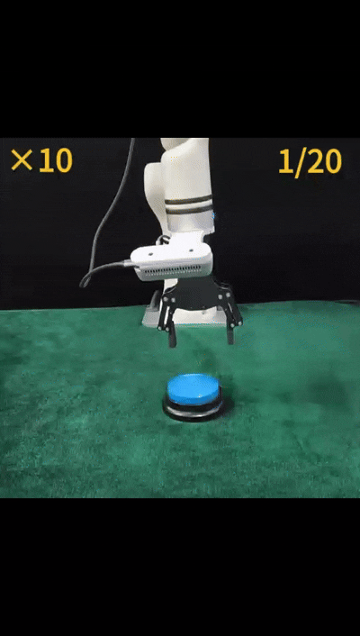
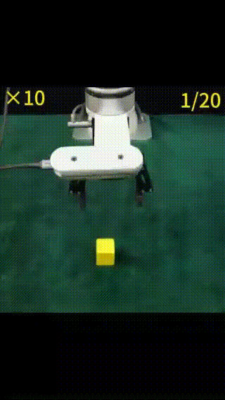

Official implementation of **From Scalar Rewards to Potential Trends: Shaping Potential Landscapes for Model-Based Reinforcement Learning**
## Conda setup
Execute the following installation commands step by step.
```
$ conda create -n slope python=3.10

$ pip install torch==2.6.0 torchvision==0.21.0 torchaudio==2.6.0 --index-url https://download.pytorch.org/whl/cu118

$ pip install absl-py==2.1.0 glfw==2.7.0 ffmpeg==1.4 imageio==2.34.1 imageio-ffmpeg==0.4.9 h5py==3.11.0 hydra-core==1.3.2 hydra-submitit-launcher==1.2.0 submitit==1.5.1 omegaconf==2.3.0 moviepy==1.0.3 mujoco==2.3.7 numpy==1.24.4 kornia==0.7.2 termcolor==2.4.0 tqdm==4.66.4 pandas==2.0.3 wandb==0.17.4 matplotlib==3.7.5 seaborn==0.13.2 gpustat==1.1.1

$ pip install torchrl-nightly==2025.2.3

$ pip install tensordict-nightly==2025.2.3

$ pip install git+https://github.com/Farama-Foundation/Metaworld.git@c822f28f582ba1ad49eb5dcf61016566f28003ba#egg=metaworld

$ pip install git+https://github.com/haosulab/ManiSkill.git@0de43f1f5e10dabd860baacbcbd10ab443e998b1#egg=mani-skill

```

## Training

```
# Run SLOPE
$ python train.py task=ms-poke-cube-sparse steps=500000 demo_path=/path/to/expert_demos/ms-poke-cube-sparse.pkl enable_reward_learning=false reward_shapping=true warm_MPPI=true update_succ_buffer=true use_quantile_loss=true n_demos=5 seed=1

# Run DEMO3
$ python train.py task=ms-poke-cube-sparse steps=500000 demo_path=/path/to/expert_demos/ms-poke-cube-sparse.pkl enable_reward_learning=true n_demos=5 seed=1

# Run MoDem
$ python train.py task=ms-poke-cube-sparse steps=500000 demo_path=/path/to/expert_demos/ms-poke-cube-sparse.pkl enable_reward_learning=false n_demos=5 seed=1

# Run TD-MPC2
$ python train.py task=ms-poke-cube-sparse steps=500000 enable_reward_learning=false demo_sampling_ratio=0.0 policy_pretraining=false seed=1
```


## Evaluation on Real Robot

The following videos demonstrate the task performance. **Note:** The GIF files are located in the `./assets/` directory.

<table style="width:100%">
  <tr>
    <td align="center" style="width: 20%">
      
      <br><strong>Press Button</strong>
    </td>
    <td align="center" style="width: 20%">
      
      <br><strong>Push Cube</strong>
    </td>
    <td align="center" style="width: 20%">
      
      <br><strong>Grasp Cube</strong>
    </td>
  </tr>
</table>